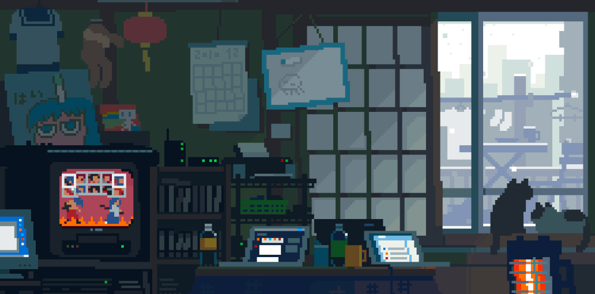

  

 

<!-- HEADER -->

# ☘︎ hello, i'm Nyashia Carrington

**software engineering student · lifelong learner · curious mind**

*building things, exploring ideas, and growing one commit at a time.*

✿ · · ─────── ·𖥸· ─────── · · ✿

<!-- ABOUT ME -->

### 🌱 a little about me

I'm a software engineering student with a curiosity for how things work and a love for learning new things.

- ☕ Currently strengthening my **Java** and **JavaScript** skills through personal projects
- 🌿 Exploring backend and full-stack development
- 🧩 Interested in creative problem-solving and new perspectives
- ✨ Learning by building, experimenting, and improving along the way

### 🪴 things i work with

### 🍃 things i've been building

**StudHub** — a collaborative study platform designed to help students connect, study together, and stay accountable.

**Research Mate** — a research paper assistant exploring paper discovery and AI-powered summarisation.

### 📊 my github garden

### ☁️ let's connect

*“curious mind, open perspective, always learning.”*

♡ thanks for stopping by ♡

